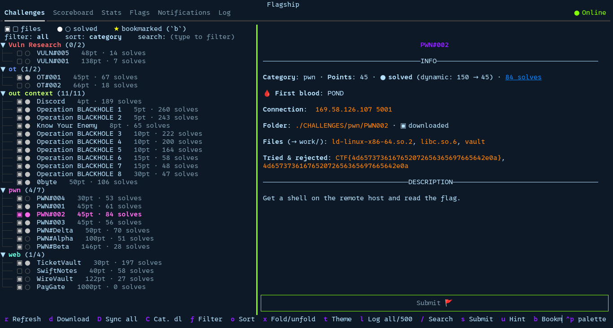
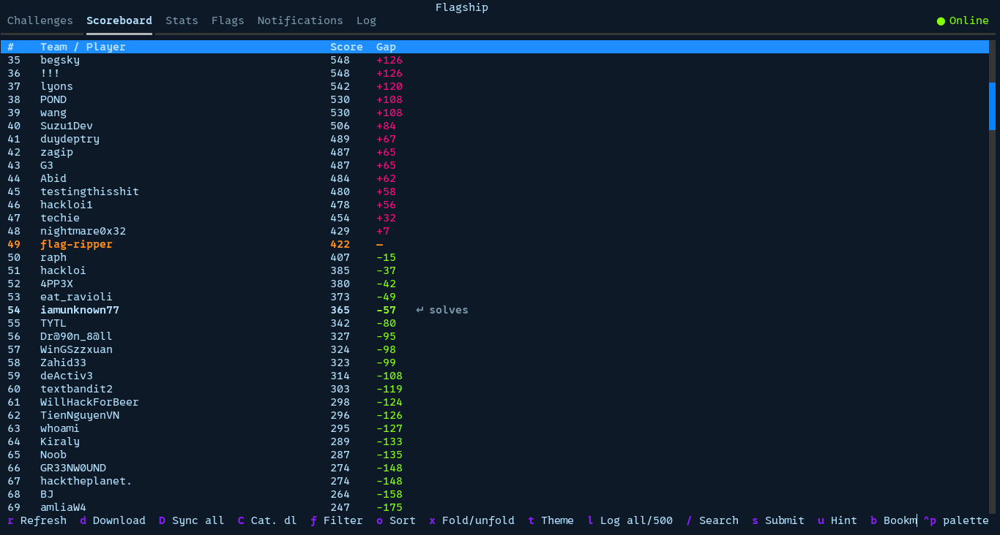
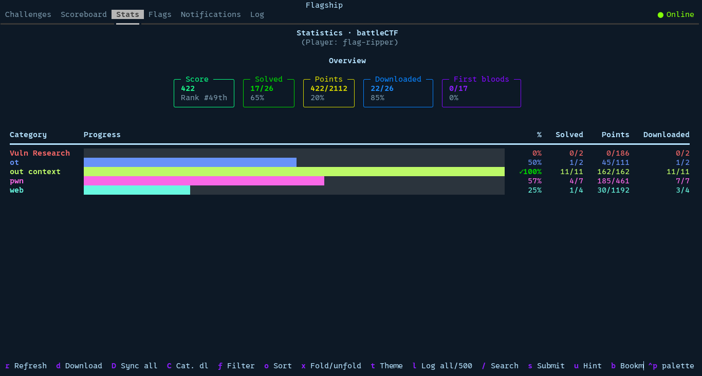
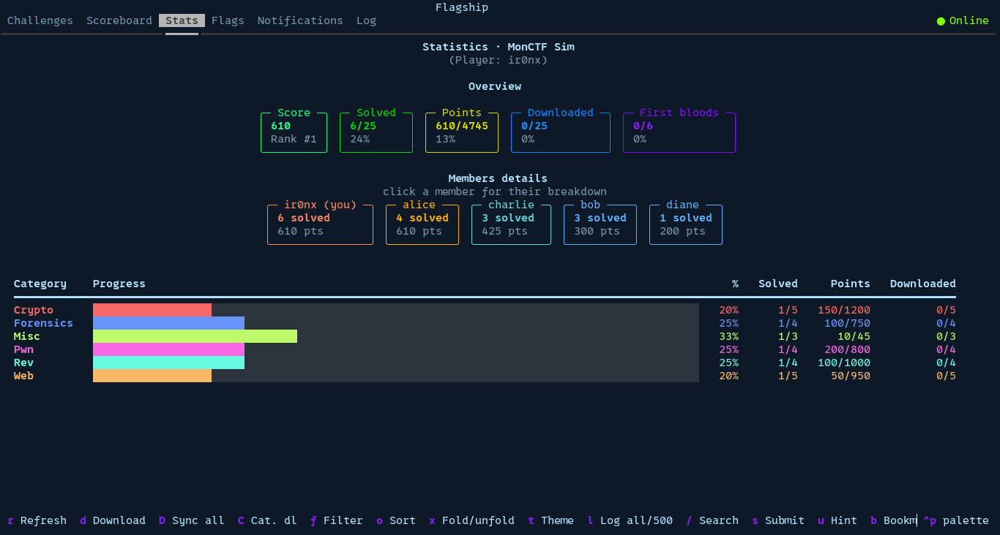
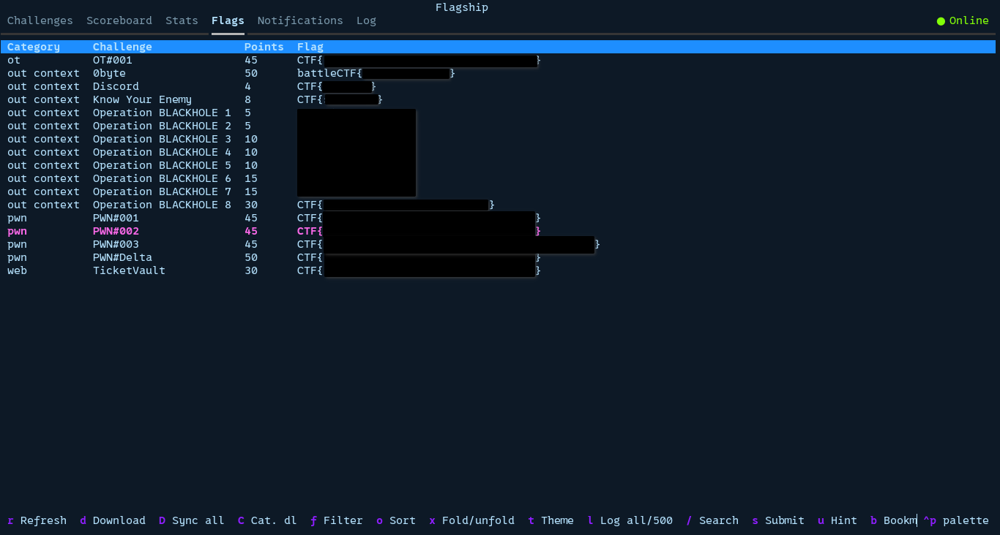

# 🚩 Flagship (Documentation FR)

Nouveau CTF, même routine : créer des dossiers, télécharger les fichiers, suivre les
résolutions, tenir des notes par challenge. Flagship fait tout ça pour toi.

## Preview



> L'interface de Flagship et les fichiers générés (`<nom-du-challenge>.txt`, `<nom-du-challenge>.md`…) sont en anglais.

## Aperçus

**Scoreboard**



**Stats (CTF solo)**



**Stats (CTF en équipe)**



**Flags**



## Fonctionnalités

- Liste les challenges
- Télécharge les challenges : un seul, une catégorie entière, ou tous les challenges
- Suit les résolutions, écrit `flag.txt` quand un flag est validé
- Détecte les changements de description/indices (`<nom-du-challenge>-v2.txt`, `<nom-du-challenge>-v3.txt`…)
- Soumet les flags
- Mémorise les flags refusés pour ne pas les renvoyer
- Challenge à essais limités: fenêtre de confirmation avant de soumettre.
- Débloque les indices (pop-up de confirmation pour les payants)
- Recherche, filtre (tous / non résolus / résolus / favoris) et tri
- Épingler un challenge en favori
- Notes par challenge (`<nom-du-challenge>.md`) dans l'éditeur de ton choix
- Scoreboard complet, double-clic (ou Entrée) pour voir l'historique de solves
- Colonne « Gap » : écart de points par rapport à toi (vert = tu mènes, rouge = on te devance)
- Stats : score, rang, résolus, points, first bloods (détail par membre en équipe ; clique sur la carte
  d'un membre pour son historique de résolutions : challenge, catégorie, points et date, du plus récent au plus ancien)
- Tout mis en cache local: consultable hors-ligne et après le CTF
- Panneaux redimensionnables, thèmes de couleur
- Export Markdown des flags et de la progression
- Export de toutes les notes rédigées en un seul zip, rangé par catégorie (`N`)
- Six onglets : Challenges, Scoreboard, Stats, Flags, Notifications (annonces de la
  plateforme), Log (journal interne)

## Installation

```bash
cd /workspace/flagship
pip install -e .            # installe Flagship + dépendances, ajoute la commande `flagship`
```

## Configuration

```bash
cp config.sh.example config.sh
$EDITOR config.sh
```

```sh
URL=https://ctf.example.com          # URL du CTFd
CTFD_TOKEN=ctfd_xxxxxxxxxxxxxxxxxxx  # token (CTFd > Settings > Access Tokens)

# optionnel
CTF_NAME=MonCTF              # nom affiché et dossier par défaut
BASE_DIR=./                  # racine des dossiers générés (relatif au config.sh)
POLL_INTERVAL=60             # synchro auto toutes les N secondes (0 = désactivée)
WRITE_FLAG_ON_SOLVE=true     # écrire flag.txt quand un flag est validé
WATCH_CHANGES=true           # suivre les changements desc/indices (false = synchro plus légère)
WATCH_INTERVAL=300           # délai mini (s) entre deux passes de suivi complètes (0 = à chaque poll)
AUTO_UNLOCK_FREE_HINTS=true # débloquer automatiquement les indices gratuits
AUTO_NOTES=true             # créer automatiquement les notes <nom-du-challenge>.md (jamais écrasées)
DOWNLOAD_WORKERS=6           # téléchargements en parallèle pour "Sync all"
THEME=ansi-dark           # thème de départ (`t` pour cycler)
EDITOR=code                  # éditeur pour les notes (ex. vim, subl, code)
FLAG_PREFIX=HLB2026{           # pré-rempli dans le champ de flag quand on appuie sur s (vide = aucun)
FLAG_SUFFIX=}                 # pré-rempli après le curseur : on tape seulement l'intérieur (vide = aucun)
```

## Lancement

```bash
./flagship.sh                 # utilise ./config.sh
./flagship.sh chemin/config.sh
./flagship.sh --offline       # hors ligne : données locales seulement (voir ci-dessous)
# ou : python3 -m flagship [--offline] [config.sh]
```

Une seule installation suffit pour plusieurs CTF : chaque CTF a son propre `config.sh` (avec son
`BASE_DIR`), passé en argument. Un alias évite de retaper le chemin :

```bash
alias flagship='~/ctfs/flagship/flagship.sh'
flagship ~/ctfs/HeroCTF/config.sh
```

### Mode hors ligne (`--offline`)

`--offline` n'appelle **jamais** l'API CTFd : Flagship affiche uniquement ce qui a été mis en cache
lors des dernières synchronisations (`BASE_DIR/.flagship/`) et ce qui est déjà sur le disque.

- **Affiché** : la liste des challenges, le scoreboard, les statistiques, les flags, les notifications,
  les premiers sang, les historiques de résolution déjà consultés, et la description de chaque challenge
  lue dans son `<nom-du-challenge>.txt`.
- **Désactivé** (une notification l'indique) : rafraîchir (`r`), télécharger (`d`, catégorie, tout
  synchroniser), soumettre un flag, débloquer un indice, mettre en cache les historiques.
- **Aucune** mise à jour automatique : pas de polling, et le cache n'est pas réécrit.
- La barre de statut affiche `⚠ Offline (--offline) · sync JJ/MM HH:MM` : la date est celle de la
  dernière synchronisation réussie.

Un challenge jamais téléchargé n'a pas de `<nom-du-challenge>.txt` : sa description n'est donc pas disponible hors ligne.

## Raccourcis clavier

| Touche               | Action                                                       |
| -------------------- | ------------------------------------------------------------ |
| `↑`/`↓`, Entrée      | naviguer, ouvrir un challenge                                |
| clic sur les onglets | changer d'onglet                                             |
| `d` / `D` / `C`      | télécharger : le challenge / tout / la catégorie             |
| `/`                  | rechercher                                                   |
| `r`                  | rafraîchir                                                   |
| `f` / `o`            | changer de filtre / de tri                                   |
| `b`                  | favori on/off                                                |
| `x`                  | replier/déplier les catégories                               |
| `t`                  | changer de thème                                             |
| `l`                  | onglet Log : basculer 500 dernières ↔ historique complet     |
| `s`                  | focus sur le champ de flag                                   |
| `u`                  | débloquer un indice                                          |
| `c` / `w`            | copier la connexion / ouvrir le dossier                      |
| `e`                  | éditer les notes (`<nom-du-challenge>.md`)                                |
| `p` / `P`            | exporter la progression / l'onglet Flags                     |
| `N`                  | exporter les notes rédigées dans un zip (`notes-export-*.zip`) : toutes ou résolues seulement |
| `A`                  | mettre en cache l'historique de solves de tout le scoreboard |
| `Échap`              | quitter le champ actif                                       |
| glisser `┃`          | redimensionner les panneaux (double-clic : réinitialiser)    |
| `q`                  | quitter                                                      |

## Thèmes

- **Sombres (15) :** `ansi-dark`, `atom-one-dark`, `catppuccin-frappe`, `catppuccin-macchiato`,
  `catppuccin-mocha`, `dracula`, `flexoki`, `gruvbox`, `monokai`, `nord`, `rose-pine`,
  `rose-pine-moon`, `solarized-dark`, `textual-dark`, `tokyo-night`
- **Clairs (6) :** `ansi-light`, `atom-one-light`, `catppuccin-latte`, `rose-pine-dawn`,
  `solarized-light`, `textual-light`

## Architecture

| Fichier       | Rôle                                                     |
| ------------- | -------------------------------------------------------- |
| `config.py`   | Lit `config.sh` (sans passer par un shell)               |
| `ctfd.py`     | Client de l'API CTFd                                     |
| `store.py`    | crée les dossiers, fichiers, téléchargements et le cache |
| `app.py`      | L'interface TUI (Textual)                                |
| `__main__.py` | Point d'entrée                                           |

## Téléchargements

Les fichiers vont dans `work/`. Un fichier de plus de **2 Go n'est pas téléchargé**
automatiquement (pour ne pas saturer le disque) : il est marqué `manual` et son lien
reste dans `<nom-du-challenge>.txt` pour une récupération à la main.

Chaque challenge reçoit un rapport `downloads.txt` où chaque ligne porte une indication :

| Indication | Signification                                                              |
| ---------- | -------------------------------------------------------------------------- |
| `ok`       | fichier téléchargé dans `work/`                                            |
| `skip`     | déjà présent, non écrasé                                                   |
| `page`     | page web (pas un fichier) : conservée dans `<nom-du-challenge>.txt`, non téléchargée     |
| `manual`   | à récupérer à la main (lien dans `<nom-du-challenge>.txt`) : > 2 Go, Drive privé, MEGA…  |
| `error`    | le téléchargement a échoué                                                 |

## Arborescence

Exemple d'organisation des fichiers générés:

```
MonCTF/                             # racine de ton CTF (BASE_DIR)
├── config.sh                       # URL + token (jamais affiché)
├── PROGRESS_flagship.md            # tableau de progression généré (touche p)
├── FLAGS_flagship.md               # export des flags généré (touche P)
├── notes-export-*.zip              # toutes les notes rédigées, par catégorie (touche N)
├── .flagship/                      # cache & état interne (ne pas toucher)
└── CHALLENGES/
    ├── Crypto/
    │   ├── crypto1/
    │   │   ├── <nom-du-challenge>.txt            # énoncé du challenge
    │   │   ├── work/               # fichiers téléchargés
    │   │   ├── <nom-du-challenge>.md            # tes notes (touche e)
    │   │   └── flag.txt            # écrit quand le flag est validé
    │   └── crypto2/
    │       ├── <nom-du-challenge>.txt
    │       └── work/
    └── Forensics/
        ├── forensics1/
        │   ├── <nom-du-challenge>.txt
        │   ├── work/
        │   └── flag.txt
        └── forensics2/
            ├── <nom-du-challenge>.txt
            └── work/
```

`<nom-du-challenge>.txt` = énoncé · `work/` = fichiers téléchargés · `<nom-du-challenge>.md` = tes notes · `flag.txt` = apparaît une fois le flag validé.

## Tests

```bash
pip install -e ".[test]"
python -m pytest                    # tests unitaires + TUI, contre un faux CTFd en mémoire (sans réseau)
```

Les tests « live » tournent sur un **lab CTFd local et fictif** (jamais un vrai CTF). Clone le dépôt
officiel de CTFd, installe ses dépendances, puis amorce un lab et pointe les tests dessus :

```bash
git clone --depth 1 https://github.com/CTFd/CTFd.git /chemin/vers/CTFd
python tests/lab/seed_ctfd.py /chemin/vers/CTFd /chemin/vers/lab/ctfd.db 8101 users /chemin/vers/lab/token
FLAGSHIP_LIVE_URL=http://127.0.0.1:8101 FLAGSHIP_LIVE_MODE=solo \
  FLAGSHIP_LIVE_TOKEN="$(cat /chemin/vers/lab/token_player)" FLAGSHIP_LIVE_ADMIN_TOKEN="$(cat /chemin/vers/lab/token)" \
  python -m pytest tests/test_live_ctfd.py tests/test_live_tui.py
```

Le script écrit les jetons dans des fichiers (jamais affichés). Mode `users` (solo) ou `teams` (équipe).

## À noter

- Solo ou équipe est détecté automatiquement
- CTF fini ou hors-ligne : Flagship réaffiche la dernière synchro en cache.
- Conçu pour CTFd ; les autres plateformes ne sont pas prises en charge.
